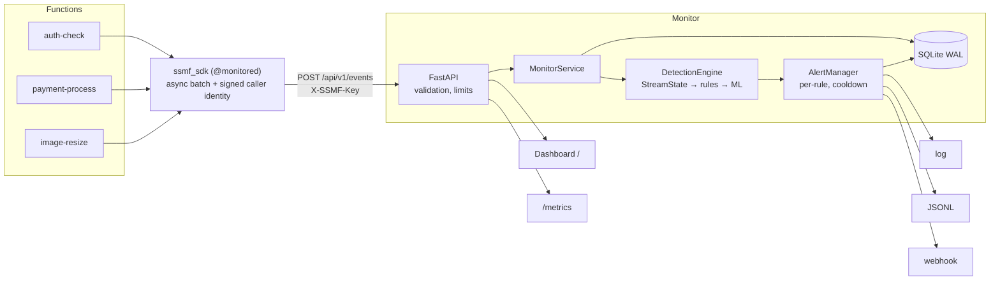

# SSMF architecture

## 1. Problem and scope

Self-hosted FaaS platforms (OpenFaaS, Knative) expose pod-level logs and metrics. Those describe containers, not
*function invocations*, so call-chain abuse, invocation floods against a single function, and credential attacks
spread across functions are hard to see before the instance that served them is gone.

SSMF monitors **invocations**. In scope: detection and alerting for the attack classes below on a self-hosted FaaS.
Out of scope: blocking traffic (it is a detector, not a WAF), image/dependency scanning, managed-cloud FaaS.

Attack classes covered (the names follow the OWASP Serverless Top 10 categories; check the current numbering on the
OWASP page when you cite it): denial of service / financial resource exhaustion, broken authentication, serverless
business-logic manipulation, function-event data abuse (oversized input), and inadequate monitoring itself.

## 2. Components and data flow

1. **SDK** wraps a handler, measures duration/payload/status, resolves the caller identity, and queues an event.
   A daemon thread ships batches (50 events or 0.5 s). The queue is bounded: under pressure it sheds events
   rather than slowing the function. Failures are swallowed (one stderr warning per 30 s).
2. **API** validates every field against a strict pattern and range before anything touches the engine.
3. **StreamState** keeps O(1)-amortised sliding-window counters (per function, per source, auth failures, 5xx)
   and exponentially-weighted per-function baselines of log(payload) and log(duration).
4. **RuleEngine** evaluates the policy and baselines and produces explainable hits (each carries its reason).
5. **MLDetector** scores a feature vector with the learned model; the **persistence filter** requires the same
   source to be flagged twice within the window before an ML hit is raised.
6. **AlertManager** emits one alert per (function, rule, source) and folds repeats into it (`suppressed` counter).
7. **Storage** persists events and alerts (bounded retention); the dashboard and `/metrics` read from the service.

All detection uses **event timestamps**, so the identical code serves live traffic and accelerated replay in the evaluation.

## 3. Event schema

| Field | Meaning |
|---|---|
| `invocation_id` | Correlation id (`X-Call-Id` when the platform provides it) |
| `timestamp` | Epoch seconds (start of the invocation) |
| `function_name`, `caller` | Callee, and `external` or the calling function; `spoofed:<x>` if the signature failed |
| `source_ip` | First `X-Forwarded-For` entry. *Only trustworthy if your gateway overwrites that header.* |
| `status_code`, `duration_ms`, `payload_size_bytes` | Outcome, cost and input size |

## 4. Detection design

### Rules (explicit, auditable)
Each rule returns a human-readable reason (for example "source 203.0.113.9 made 41 calls in 10s (limit 40)").
Thresholds and the call graph live in `ssmf/default_policy.yaml`. Notable design points:

* **Flood detection is source-attributed**: `src_count > limit`, or the function is over its volume limit *and* this
  source contributes at least 20% of it. Legitimate callers are not flagged while someone else floods, and a legitimate
  surge across many clients does not alert.
* **Auth-failure counts are per source across all functions**, so a source that has just failed authentication 30 times
  stays suspicious when it moves to another function (visible in the demo as `AUTH_BRUTEFORCE` on `data-export`).
* **Baseline-poisoning guard**: events that trip any rule never update the baseline.
* **z-score floor** (`min_log_std`) stops very stable functions from over-firing on tiny deviations.

### ML (adaptive, unsupervised)
* Learns from the first 800 clean events; 30% of them are held out (interleaved, not chronological) to calibrate the
  alarm threshold, so the false-positive target is set on data the model has not seen.
* Features: `payload_z`, `duration_z` (function-normalised), `log(src_count)`, `auth_fail_src`, `is_error`.
  Function-wide volume is **deliberately excluded**: it made legitimate callers look anomalous during someone else's flood.
  `caller_known` is excluded because a feature that never varies in training cannot be learned from; rules own it.
* **Algorithm choice was empirical** (see `docs/EVALUATION.md`, section 3): Isolation Forest reached ~12% recall because
  it scores out-of-range points only marginally lower than normal ones; LOF reaches ~88%; Mahalanobis ~83%.
  All three remain selectable (`ml.algorithm`).
* ML-only findings are ranked `low` severity; they escalate one level only when an explicit rule agrees.

### Scoring
Each rule has a weight; risk = sum, capped at 100. Severity = the highest rule severity, raised one level when two
independent signals agree.

## 5. Threat model of the monitor itself

A security monitor is a high-value target; SSMF treats its own inputs as hostile.

| Threat | Mitigation |
|---|---|
| Forged events / alert-flooding by an outsider | API key on ingest and admin (constant-time compare); NetworkPolicy in the k8s manifest |
| Log, metric or HTML injection through function name, caller, IP | Strict identifier patterns at the API *and* in the SDK; Prometheus label escaping; dashboard renders with `textContent` only |
| Oversized requests | 1 MB body limit, 1000 events/request, bounded numeric ranges |
| Memory exhaustion via spoofed sources | Windows are garbage-collected and capped; alert and ML-flag maps are bounded |
| Baseline poisoning | Flagged events never train the baseline |
| Caller-identity spoofing | HMAC over `caller|timestamp` with a 5-minute skew window; failures become `spoofed:*` |
| Detection pipeline crash from a bad sink | Sinks are isolated; exceptions are logged, never propagated |
| Clickjacking / content sniffing | `X-Frame-Options: DENY`, `nosniff`, CSP, `Referrer-Policy` |

Residual risks: the caller secret is shared (rotate it; a secrets manager is better than env vars), read endpoints are
unauthenticated by default, `X-Forwarded-For` is only as trustworthy as your gateway, and TLS must be terminated by your ingress.

## 6. Scalability and limits

Single process, single replica: detection state is in memory. Measured on a noisy sandbox (`docs/EVALUATION.md`):
tens of thousands of events/s in batch, sub-millisecond per-event latency. Beyond that: shard by function name behind a
consistent-hash router, or move windows to Redis. Not implemented; stated here so it is a known limit, not a surprise.

## 7. Alternatives considered

| Choice | Alternative | Why this one |
|---|---|---|
| Push model (SDK) | Parse pod logs | Structured, low-latency, carries caller identity; log-tailing remains possible via `SSMF_STDOUT_LOG=1` |
| LOF default | Isolation Forest | Measured: IF misses large anomalies on this data |
| Rules + ML hybrid | ML only / rules only | Each misses a class the other catches (section 4 results) |
| SQLite | Postgres / TSDB | Zero-ops, adequate for one replica; the `Store` interface is small to swap |
| In-process state | External state store | Simplicity and latency; documented scale limit |
