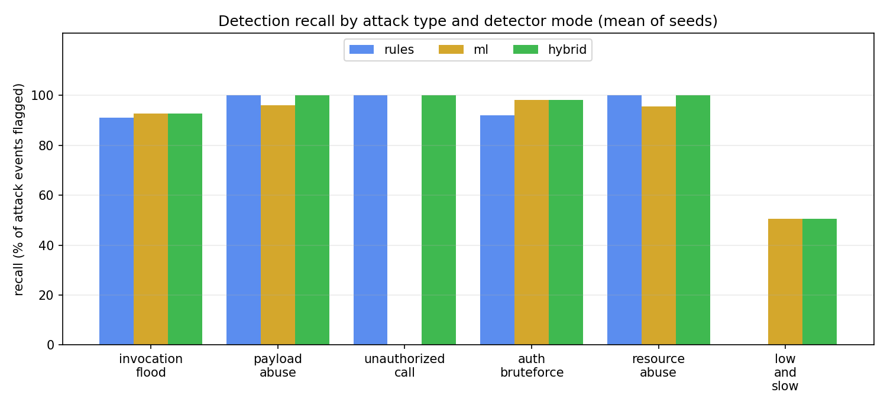
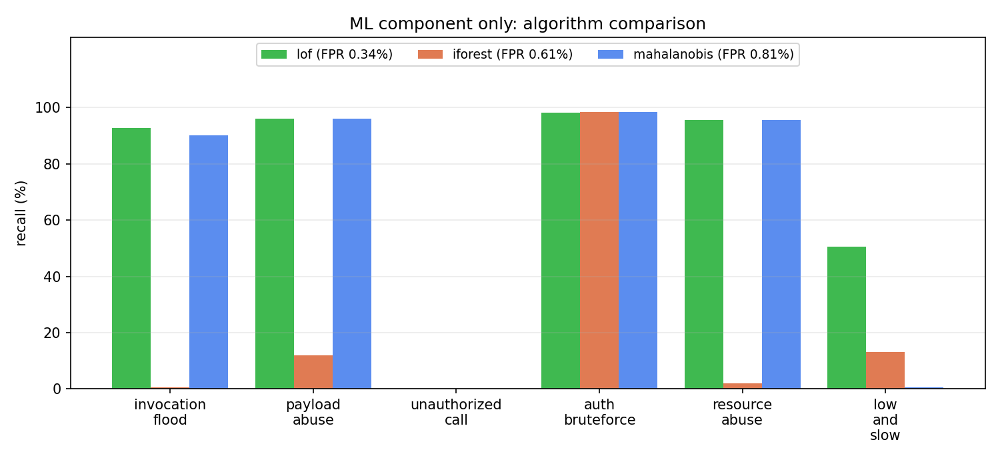

# SSMF evaluation results

Generated by `tools/evaluate.py` - 5 seeds x 20,000 normal events + 3 bursts of each of 6 attack types per seed (baseline warm-up 3,000 clean events). All figures are means over seeds.

## 1. Detection quality (event level)

| Mode | Precision | Recall | F1 | False-positive rate | Bursts detected | Mean time-to-detect |
|---|---|---|---|---|---|---|
| rules | 99.9% ± 0.1 | 86.2% ± 1.1 | 92.5% ± 0.6 | 0.01% ± 0.01 | 75/90 | 0.14 s |
| ml | 96.2% ± 3.3 | 88.4% ± 2.4 | 92.1% ± 0.6 | 0.34% ± 0.31 | 75/90 | 0.87 s |
| hybrid | 96.3% ± 3.2 | 91.4% ± 2.6 | 93.7% ± 0.6 | 0.35% ± 0.31 | 90/90 | 0.41 s |

## 2. Recall by attack type

| Attack | rules | ml | hybrid |
|---|---|---|---|
| invocation_flood | 91% | 93% | 93% |
| payload_abuse | 100% | 96% | 100% |
| unauthorized_call | 100% | 0% | 100% |
| auth_bruteforce | 92% | 98% | 98% |
| resource_abuse | 100% | 96% | 100% |
| low_and_slow | 0% | 50% | 50% |

## 3. ML algorithm comparison (ML component only)

| Algorithm | Precision | Recall | F1 | False-positive rate |
|---|---|---|---|---|
| lof (default) | 96.2% ± 3.3 | 88.4% ± 2.4 | 92.1% ± 0.6 | 0.34% ± 0.31 |
| iforest | 66.4% ± 9.4 | 11.9% ± 1.5 | 20.1% ± 1.9 | 0.61% ± 0.26 |
| mahalanobis | 90.6% ± 6.0 | 83.2% ± 0.6 | 86.7% ± 2.8 | 0.81% ± 0.51 |

## 4. Speed

| Mode | Batch throughput (events/s) | Per-event latency p50 | p95 | p99 |
|---|---|---|---|---|
| rules | 137,223 | 0.006 ms | 0.007 ms | 0.014 ms |
| ml | 60,011 | 0.338 ms | 0.433 ms | 0.529 ms |
| hybrid | 62,762 | 0.338 ms | 0.433 ms | 0.492 ms |

Batch throughput = events processed per second when replayed in micro-batches of 500 (single process, includes ML scoring). Per-event latency = one `process_event` call at a time. Timings were taken on a shared, noisy machine and varied by up to ~2x between runs, so read them as orders of magnitude (tens of thousands of events/s; sub-millisecond latency) and re-run `tools/evaluate.py` on your own hardware for figures you intend to quote. Detection metrics, by contrast, are deterministic for a given seed.

## 5. Instrumentation overhead (SDK)

| Variant | Time per call |
|---|---|
| bare handler | 0.07 us |
| `@monitored` (async reporter, default) | 9.70 us |
| `@monitored` (inline / `SSMF_SYNC=1`, network excluded) | 4.32 us |

Added latency of the default (async) SDK: about **9.6 us per invocation** (event construction + queue put; the network send happens on a background thread). This is a tight-loop micro-benchmark in which the background sender competes for the interpreter lock, so it is an upper bound for real handlers; compare it with the milliseconds a real function spends doing work.

## 6. Reading these results honestly

* **'Best' depends on the goal.** Rules-only has the highest precision and F1 (very few false alarms). Hybrid has the highest recall and is the only mode that detected every attack burst, at the cost of about 1% more false positives. If missing an incident is worse than reviewing a low-severity alert, hybrid is the right default; if alert fatigue dominates, run `SSMF_MODE=rules`.
* **Complementary, not redundant.** Rules never fire on `low_and_slow` (it stays under every explicit limit) while the ML model does; the model cannot learn call-graph violations (`unauthorized_call`) because that signal never varies in training, while rules catch them every time. Hybrid inherits both.
* **The price of ML.** The raw model flags roughly 1% of clean events. Three controls keep that manageable: a persistence filter (the same source must be flagged twice within the window, because attacks are bursts and false positives are isolated), ML-only alerts are ranked `low` severity and only escalate when a rule agrees, and alert cooldown folds repeats into one alert.
* **Isolation Forest underperforms here.** It scores far-out-of-range points only marginally lower than normal ones, so large anomalies slip through; LOF (distance-based) does not share that weakness, hence the default.
* **Floods:** recall is below 100% by design - the first calls of a burst arrive before the rate threshold is crossed. Time-to-detect above shows how quickly that happens.
* **Synthetic data.** Traffic comes from `tools/simulator.py`, the same family of generators the detectors were developed against (tuning used different seeds from this evaluation). Treat absolute numbers as indicative; validate on a real OpenFaaS/Knative deployment before relying on them.
* **Not covered:** `ERROR_SPIKE` has no attack scenario here (it is unit-tested), and a flood spread thinly over thousands of sources is a known gap - use platform rate limiting for that.
